<div align="center">

<picture>
  <source media="(prefers-color-scheme: dark)" srcset="assets/wordmark-dark.png">
  <source media="(prefers-color-scheme: light)" srcset="assets/wordmark-light.png">
  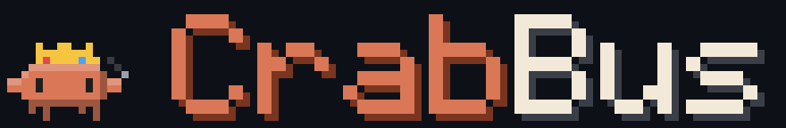
</picture>

### See what every Claude Code subagent is really doing, with pixel crabs.

[](LICENSE)
[](https://claude.com/claude-code)
[](tsconfig.json)
[](#requirements)
[](#how-it-works)

[Features](#features) · [Install](#install) · [Usage](#usage) · [Customize](#customize-your-crew) · [How it works](#how-it-works) · [Configuration](#configuration)

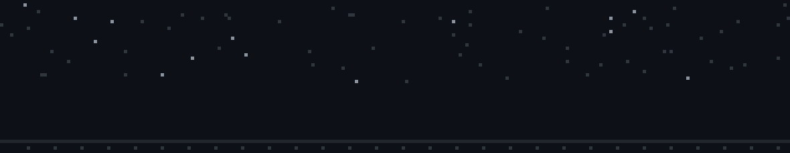

</div>

---

**CrabBus** is a Claude Code mod for orchestrating ordinary subagents. The main agent (the
*master*) gets an accurate picture of what every subagent is doing, can message any of them and
track the message until it lands, and sees tokens and cost per agent. You see all of it live as a
crew of animated pixel crabs in your terminal. The same plugin also renders SVG crabs and the
shared controls in Claude Desktop, with animation driven by the same frame engine as the terminal.

<p align="center">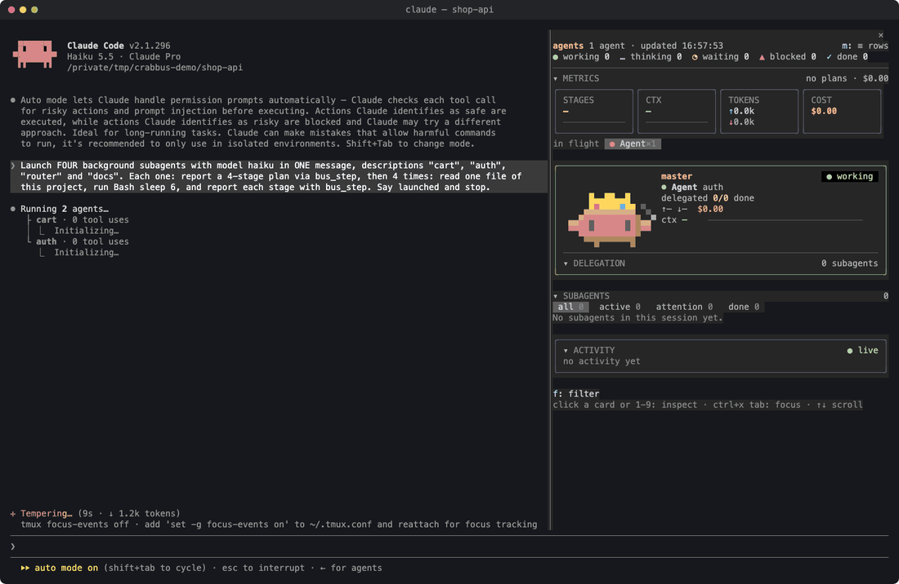</p>
<p align="center"><sub>A real recording: four Haiku subagents, tracked from launch to done (sped up 2×).</sub></p>

## Why

When a master launches five subagents in the background, it can't see what they are doing. It
waits, guesses, or sends the same instruction twice. Progress bars make it worse when "4 of 5
steps" is shown as "80 % done".

CrabBus keeps three kinds of information apart and never mixes them:

| Layer | Source | Example |
|---|---|---|
| **OBSERVED** | Claude Code's hooks: what actually happened | last tool and its argument, files edited, test commands and their result, tokens |
| **DECLARED** | The agent's own reports through `bus_step` | plan, stages done, current step, blockers, questions |
| **VERIFIED** | Declared stages that come with attached evidence | "stage 3: `npm test` → 42 passing" |

"4/5 stages declared done" is shown as exactly that, never as 80 % of the work.

## Features

### 🦀 A live crew above your prompt
One crab per running subagent, each in its own costume, acting out what it is **really** doing:
reading, writing, testing, thinking, blocked, error, done or asleep. The crowned master stands on
the right. In the terminal, envelopes fly from the master to an agent and rest on its head until
the agent acknowledges them. Desktop requests those same animation frames through Client.

<p align="center">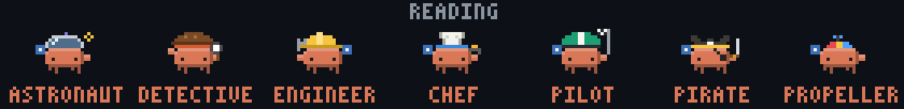</p>

### ✉️ Two-way messaging you can trust
Messages travel both ways, and every hop is labeled with how CrabBus knows about it:

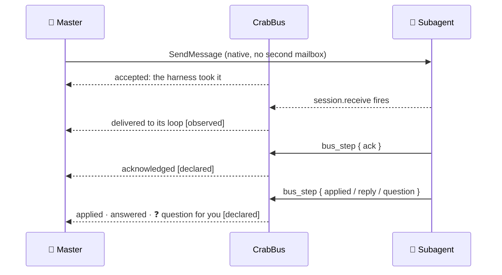

- **Master → agent:** the master uses Claude Code's own `SendMessage`. CrabBus watches it and does
  not change it.
- **Agent → master:** subagents report their plan, progress, blockers, **questions** and replies
  with `bus_step`. A question shows up as a ❓ on the crab and in `bus_status`.
- **You → agent:** open any agent in the `/bus` panel and type a message to it. It is tracked like
  the master's own messages.

### 💸 Tokens, cost and your plan's usage limits
- Each subagent's token usage (in, out, cache hits) and **context window in use**, read from every
  model request (`turn.step`).
- An estimated cost per agent at list prices, always shown with `≈` because no API reports a
  subagent's real cost.
- The **real session total** from Claude Code's own ledger (`session.measure`), with a sparkline.
  The master's share is the total minus the estimates.
- Your plan's **usage limits** always on screen: the current 5-hour window and the weekly one, as
  bars with the local time each one resets and how long that is from now. No more typing `/usage` to check. They also show at the
  end of the line above the prompt (`5h 75% · week 54%`).

```
5h    ━━━━━━━━━━━━━━━━━━──────  79%  resets 21:10 · in 2h 35m
week  ━━━━━━━━━━━━━───────────  55%  resets Sun 13:00 · in 4d 18h
```

### 📊 The `/bus` panel
<p align="center">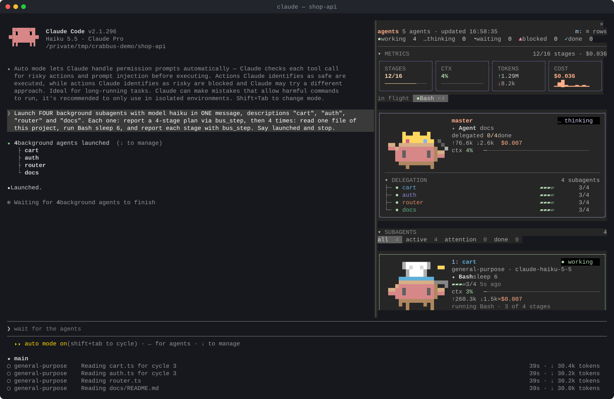</p>

- **METRICS:** declared stages as `done/total`, the master's context, tokens in/out, the real
  cost with a sparkline, and tools in flight.
- **The master's card** with its delegation tree.
- **SUBAGENTS** as cards (full crab, state chip, current tool, stages, context bar, tokens, cost)
  or as compact rows. Filter them by all, active, attention or done.
- **ACTIVITY:** a live feed of events.
- **Agent detail:** its transcript, read from the session (`all / tools / reasoning`), a field
  to message it, and DETAILS (cost breakdown, cache hits, context cells, timing, tool history,
  declared stages with evidence, messages).

<p align="center">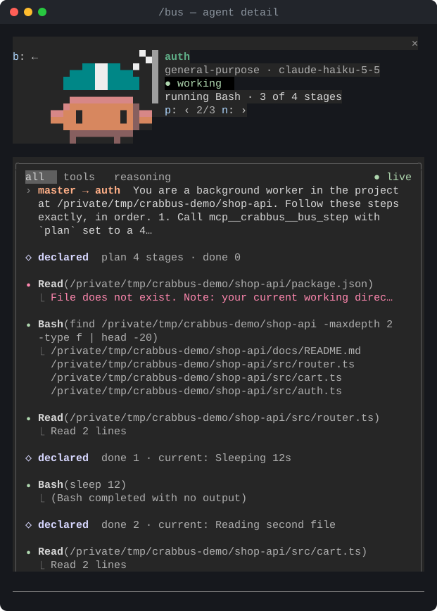</p>

| Key | Action |
|---|---|
| `1`–`9` or click | open an agent |
| `p` / `n` | previous / next agent |
| `b` | back to the list |
| `m` | cards ↔ rows |
| `f` | filter: all · active · attention · done |
| `t` | transcript tab: all · tools · reasoning |
| `a` / `w` | the agents / wardrobe tab |
| `1`–`9` in the wardrobe | pick a costume on the page |

### 🖥️ Claude Desktop, the same crew

Open **Claude Code** in the Desktop app and use a **local session** on this computer. The same
plugin provides `/bus` and `/costume`, with the same agent state, filters, messaging and design files.

- **Animated SVG crabs:** the terminal and Desktop share the pixel art, costumes, frame engine
  and director. Desktop uses Client to update frames without rebuilding the whole panel.
- **Native controls:** buttons and message fields, flexible card text, graphical context/usage
  bars and cost history. Desktop does not copy terminal spacing or ASCII graphs.
- **A stable 2×2 wardrobe:** four slots per page, fixed card heights and space reserved before
  sprites load. Previous/Next keep occupied Client instances and their timers; the last page
  retains empty slots so the grid does not shrink or stretch.
- **A visible master:** the agents panel includes it even with no subagents. With the panel
  closed, Desktop also shows it above the prompt when the crew is empty, respecting `band=off`
  and survey visibility.
- **Controlled refresh:** wardrobe animation updates only its art; state, designs and controls
  redraw when they change. List age labels refresh every five seconds and detail transcripts
  every second. `reduceMotion` keeps still poses on both surfaces.

Desktop drawing has been observed in the app. Layout, pagination, timer continuity and fallback
contracts are tested against both its bundled 2.1.295 engine and the 2.1.300 CLI. Final visual
checks of pagination smoothness, zoom, themes and performance remain listed in
[Desktop verification](docs/RENDERING.md#desktop-verification). The GIFs and screenshots above
show the terminal renderer.

### 🚦 Permission requests stay visible
When Claude Code asks *you* to approve a subagent's tool call, that crab turns **blocked** and
shows the command until you answer Claude Code's own dialog. The panel only displays the request.
A plugin can't answer or close that dialog, and CrabBus doesn't pretend it can.

### 👗 A wardrobe you can talk to
Every costume walking in a grid on terminal and Desktop, who wears what as
readable rules, and a box where you ask for a new costume, a new rule, or a whole new creature
in your own words: crabs, robots and capybaras can share one crew. See [Customize your crew](#customize-your-crew).

## Customize your crew

Everything about the crew can be changed from the panel: what each costume looks like, which agent
wears which, and who the master is. Open the **wardrobe** with the `wardrobe` tab at the top of the
panel (key `w`) or with `/costume`.

### Tell CrabBus: just say what you want

The box at the top of the wardrobe takes plain words, in any language. Press Enter and CrabBus hands
your request to Claude, which does it with the bundled **`design` skill**:

| You type | What happens |
|---|---|
| *"make me a pumpkin crab, like a jack-o'-lantern mask"* | a new costume is drawn, checked and installed |
| *"a Peru football fan: chullo, the jersey with the red sash, a little flag"* | the same, with several pieces |
| *"the one who plans wears the detective"* | a rule is added to your rules file |
| *"in October everyone is a pumpkin"* | a rule with a date range |
| *"make the dino the master"* · *"take the capybara out of the rotation"* | the master or the rotation changes |
| *"give the pirate a bigger hat"* | an existing costume is redrawn |
| *"a capybara with a red scarf"* | a skin on the built-in capybara body |
| *"a new creature: a dog with floppy ears, not a costume"* | a new body is drawn from references, plus its first skin |

- If you name something Claude does not know well (a meme, a character, something recent), it
  searches the web first and designs from what it finds.
- To work from a picture, put its file path in the message (`based on ~/Downloads/pumpkin.png`).
- Every new costume is previewed and fit-checked before it is saved, and Claude tells you in a line
  or two what changed.
- While Claude works, the box says so. The panel reloads the folder by itself, and every rule that
  arrives is marked **new** for a few seconds.
- Each costume's card has its own box too, already about that costume: *"wear it when it reviews
  code"*, *"add a scarf"*.

Nothing is sent until you press Enter: the request shows in the conversation as a message from the
CrabBus plugin.

### The wardrobe

<p align="center">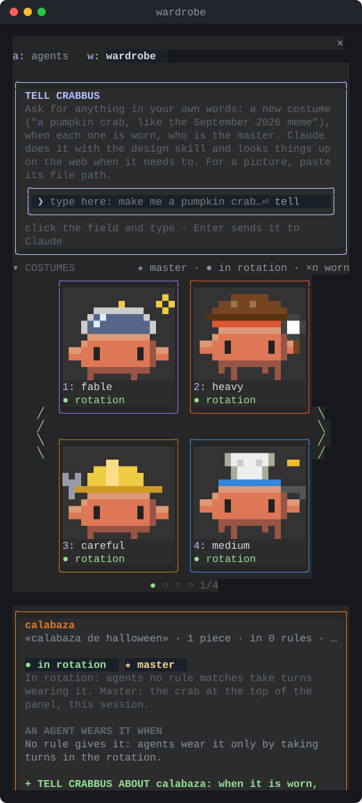</p>

**The grid** shows every costume walking at full size. Terminal pages adapt to the available
columns, with arrows at the sides. Desktop always uses a stable **2×2** grid, with Previous/Next
below it and the same reserved space on every page. Each card tells you its state at a glance:

| Mark | Meaning |
|---|---|
| ★ and a little dance | the **master**: the crab at the top of the panel, this session |
| ● rotation, colored border | **in the rotation**: agents no rule matches take turns wearing it |
| ○ off, asleep | out of the rotation: only a rule can dress an agent in it |
| ×2 | worn by two agents right now |

**Pick a costume** (click its name, or press `1`–`9`) and its card opens below the grid:

- **in rotation** and **make it the master**: two switches, applied at once.
- **An agent wears it when**: every rule that gives this costume, yours and the built-in ones.
- **Tell CrabBus about it**: the box described above, for this costume.
- **Set it by hand** (folded, for experienced users): choose what the rule looks at, type what it
  should match, press Enter.

What a rule can look at, each with its own color in the panel:

| Tag | What it reads | Example |
|---|---|---|
| `title` | the short title Claude gives the task | `bug\|fix` |
| `prompt` | the first 400 characters of the agent's instructions | `refactor\|migrate` |
| `agent type` | `Explore`, `Plan`, `general-purpose`, or a plugin's agent | `^Plan$` |
| `agent name` | the name the agent was given, when it has one | `reviewer` |
| `mode` | its permission mode: `default`, `plan`, `acceptEdits`, `auto` | `^plan$` |
| `model` | the model it runs on | `haiku` |
| `kind` | a kind of task you defined with its words under `kinds` | `planning` |
| `date` | today, between two days of the year | `10-01..10-31` |

Case does not matter; `|` means "or", `^` "starts with" and `$` "ends with". A pattern that could
hang Claude Code is refused, with the reason.

**All my rules**, below the card, lists every rule of yours in order. Move one with ▲ ▼, switch it
between *one at a time* (skipped while another agent already wears that costume) and *can repeat*,
delete it with ✕, or click its costume to open that costume's card. The built-in rules are folded
under them.

**How an agent gets its costume:** when it starts, the rules are tried from the top, yours before
the built-in ones, and the first that fits dresses it. If none fits, it takes the next costume in
the rotation. The master wears whichever costume you made the master.

Every change shows at once and is saved to your rules file (the first `"type": "rules"` file in
the designs folder). `/costume rules` prints the same in the conversation, including which rule
dressed each running agent.

### Or ask the design skill in the chat

The same skill works in a normal conversation:

> *"Give the reviewer a capybara hat"* · *"a Christmas costume for everyone"* · *"make it jump when it runs `git commit`"*

<p align="center">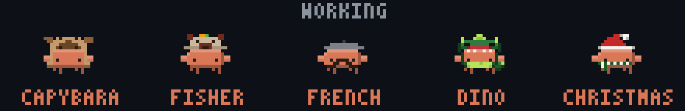</p>

It handles more than costumes:

- **Actions:** a new animation tied to a tool call, such as `git commit` in the table below.
- **Rules and kinds:** everything the wardrobe does, written as data; a `kind` names a kind of task
  by its words (`"planning": ["plan", "design"]`) so several rules can share it.
- **Labels:** rename any state (`"thinking": "… pondering"`).

### More than crabs: creatures

A costume (a **skin**) is drawn on a **body**. CrabBus ships three bodies, the `crab`, a `robot`
and a front-facing chibi `capybara`, and you can add your own: a dog, a giraffe, a penguin.

- **Each skin picks its body** with `"body": { "id": "capybara" }`. A skin without one is a crab,
  so one crew mixes species by which skin each agent wears. There is no crew-wide default.
- **Each body has as many skins as you like**: pieces can be drawn for one body
  (`"body": "capybara"` on the piece) and are refused on the others with the reason.
- **A body is JSON too**: its layers, a base `color` and a fixed `palette` (nose, ears, paws),
  two eyes that blink and look, anchors where hats and held props go, and legs that walk.
- **Bodies animate on their own**: layers take `frames` and per-action `anim`, so the capybara
  twitches its ears, sniffs while reading, chews while writing and droops its ears asleep.
- **In the wardrobe**, the picked skin's card lists every body; one that does not fit shows why
  and cannot be chosen.

To get a new creature, ask for it in so many words (*"a new creature: …"*, *"not a costume"*):
otherwise a request becomes a skin on an existing body. The skill then looks at references of
the animal, draws it front-facing to match the crew, gives it life, checks every action and
shows you the preview before installing. The [design skill](skills/design/SKILL.md) holds the
body contract and the lessons on what makes a skin look good.

```bash
/costume export capybara                       # a body to start from or share
node tools/preview.ts --design dog.json --scale 12 --out dog.png      # a body, bare
node tools/preview.ts --design dog.json dog-skin.json --costume dog-skin --out skin.png
node tools/preview.ts --design pirate.json --body capybara --out try.png   # try a skin on another body
```

### Examples

Every crab here was made by asking the skill, the last two through **Tell CrabBus**, and all of
them ship in [`examples/`](examples):

| File | What it adds | Kind |
|---|---|---|
| [`capybara.crab.json`](examples/capybara.crab.json) | a plush capybara hood | costume |
| [`capybara-fisher.crab.json`](examples/capybara-fisher.crab.json) | a crochet capybara bucket hat | costume |
| [`french.crab.json`](examples/french.crab.json) | grey beret and curly mustache | costume |
| [`dino.crab.json`](examples/dino.crab.json) | hood, suit and tail | costume |
| [`christmas.crab.json`](examples/christmas.crab.json) | santa hat and scarf | costume |
| [`pumpkin.crab.json`](examples/pumpkin.crab.json) | a full jack-o'-lantern mask whose carved face flickers like a candle, and goes out when it sleeps | costume |
| [`peru.crab.json`](examples/peru.crab.json) | a Peru football fan: colorful chullo, white jersey with the red sash, flag face paint, a waving mini flag | costume |
| [`capybara-scarf.crab.json`](examples/capybara-scarf.crab.json) | the capybara body with a red wool scarf whose end sways as it walks | costume (capybara) |
| [`commit.crab.json`](examples/commit.crab.json) | confetti and a jump whenever an agent runs `git commit` | action |
| [`rules.json`](examples/rules.json) | who wears what: by agent description (`dino`, `fisher`…) and everyone in Christmas from Dec 1–31 | rules |

```bash
/costume import examples/pumpkin.crab.json   # validated again on import
```

### Under the hood

- Every body, costume, piece, action and rule is **JSON data**, never code, kept in `~/.claude/crabbus/`
  (`/costume folder` prints the exact path).
- A **fit validator** draws each design in every action and frame, and rejects it if a piece
  floats, overflows the card, hides the eyes by accident or lacks contrast on dark or light
  terminals.
- Designs **reload live** within about 2 seconds, with no restart.
- **Share** them: `/costume export <id>` and `/costume import <file>`. `/costume list` shows what
  is installed.

Built-in crew: astronaut, detective, engineer, chef, pilot, pirate and propeller cap, plus the
crowned master. Built-in bodies: crab, robot and capybara.

## External agents: Codex, Claude profiles, Antigravity

The master can call `mcp__crabbus__bus_delegate` to launch Codex, another Claude profile,
or Antigravity in safe mode directly. No API key or intermediary model is used. Configure
the `externalAgents` plugin option as a JSON string containing this object:

```json
{
  "maxConcurrent": 3,
  "maxMinutes": 30,
  "agents": {
    "coder": { "cli": "codex" },
    "safe": { "cli": "agy", "level": "safe" },
    "claude-js": {
      "cli": "claude",
      "env": { "CLAUDE_CONFIG_DIR": "~/.claude-js" },
      "allow": ["Bash(npm test:*)"]
    }
  }
}
```

Only configured executables that answer `--version` appear in the tool description.
A new call takes `agent`, `prompt`, `description`, and optional `mode` (`edit` by default,
or `read`). Subagents cannot delegate. `to` resumes an existing external agent using its
saved provider session; busy agents queue messages FIFO, without simultaneous processes.
A continuation cannot change profile or mode. A session accepts at most 100 external
agents and 20 queued messages per agent to bound retained input.

Editing always starts from committed HEAD in `.crabbus/worktrees/<id>`, on branch
`crabbus/<cli>-<id>`. The tool reports how many uncommitted primary-checkout files are
absent. Outside Git, edit mode is refused; read mode uses the current directory. Runtime
worktrees are ignored through the repository's ignore rules or a local `info/exclude`
entry; no tracked project configuration is edited to create that exclusion.

External agents are instructed not to commit or merge. They leave tracked changes and
new files for review. **The plugin computes diffstat and untracked files from the host**
for all providers; agents do not need Git access for their completion report. Finished,
failed and cancelled worktrees remain in place. Nothing is merged or deleted automatically.

Codex uses workspace-write (or read-only), excludes /tmp and permits per-user TMPDIR so
build tools work. Claude uses the configured account with acceptEdits and its allow list;
read mode uses plan. Antigravity safe uses accept-edits: edits work and commands are denied.
`agy auto` is rejected with `agy auto is not supported yet: git fails inside its sandbox,
see PR #9` (tested with 1.3.5). Worktrees separate Git changes; provider plan/accept-edits
modes do not establish an OS filesystem sandbox. No global provider settings are edited.

The panel and bus_status show CLI identity, activity, explicit plans, denials and subscription
tokens without dollar estimates. External usage never changes Claude's dollar ledger.
The detail view uses normalized logs rather than a native transcript and offers Stop for
running or queued work. Timeout uses the same stream cancellation as Stop. Session unload
kills child processes; a plugin reload does not reconnect to an external CLI process.

Each completed turn becomes one result entry. While the master is busy, entries accumulate;
when idle, one prompt.submit carries the batch. Failed/dropped submissions retain their
entries for retry. Notifications include provider result, denials, branch, diffstat and
untracked files. Logs and response excerpts are bounded; oversized output lines are discarded
with a diagnostic. See [runtime evidence](evidence/external-gate/README.md).

## Requirements

| | |
|---|---|
| **Claude Code (terminal)** | 2.1.296 or newer |
| **Claude Desktop** | local Claude Code session with mods support; bundled engine 2.1.295 kit-tested |
| **Terminal** | truecolor recommended. In 256-color terminals the crabs are approximated. Checked on iTerm2; Terminal.app needs macOS 26 (Tahoe) or newer. Run `sh tools/check-terminal.sh` to see whether yours draws the colors |
| **Size** | about 19 rows or more for the crab band; the panel adapts down to narrow widths |
| **OS** | tested on **macOS**. Linux should work (nothing is OS-specific). Windows is untested |
| **tmux** | ❌ not needed |
| **Node / npm** | ❌ not needed to use it, only to run the specs |

> Terminal drawing uses animated Raster cells. The Desktop renderer uses Client-driven SVG frames and
> the same panel controls, with periodic state updates. Both render trees are tested with the mod
> kit. Desktop drawing has been observed in the app; the updated native layout awaits final visual review (see
> [Desktop verification](docs/RENDERING.md#desktop-verification)). Other surfaces keep their existing
> text or tool fallback; this change does not claim graphical support for them.

## Install

```bash
claude plugin marketplace add joaquinsalinas06/crabbus
claude plugin install crabbus@crabbus-local
```

Then run `/reload-plugins` in an open session. In Desktop, use the **Claude Code** tab with a
local session, then enter `/bus` or `/costume` in the chat. Run slash commands in the chat, not
in the terminal pane. This UI belongs to Claude Code sessions; the regular Chat and Cowork views
are not the surfaces tested here.

To try it for one terminal session without installing:

```bash
git clone https://github.com/joaquinsalinas06/crabbus.git
claude --plugin-dir ./crabbus
```

## Usage

Ask the master as you normally would:

> *"How are the subagents doing? Tell the third one to switch to the v2 API."*

The master calls `bus_status`, which returns each agent's id and its three layers, and then calls
`SendMessage({ to: "<id>", ... })`.

> [!TIP]
> **Address agents by id.** Claude Code rejects `SendMessage` to a description such as `"backend"`
> unless the agent was spawned with a `name`.

| Tool | Who calls it | What it does |
|---|---|---|
| `mcp__crabbus__bus_status` | master | every agent's OBSERVED / DECLARED / VERIFIED state and message delivery (optional filter by id or name) |
| `mcp__crabbus__bus_step` | subagents | report plan, stages done, current step, evidence, blockers, questions, replies, ack / applied |

| Command | |
|---|---|
| `/bus` | open the side panel on its agents tab |
| `/costume` | open the wardrobe in the side panel (or print the rules as text if there is no panel) |
| `/costume rules` | print the rules in order, the master, the rotation and which rule dressed each running agent |
| `/costume list · folder · reload · export · import · migrate` | manage crab designs |

## How it works

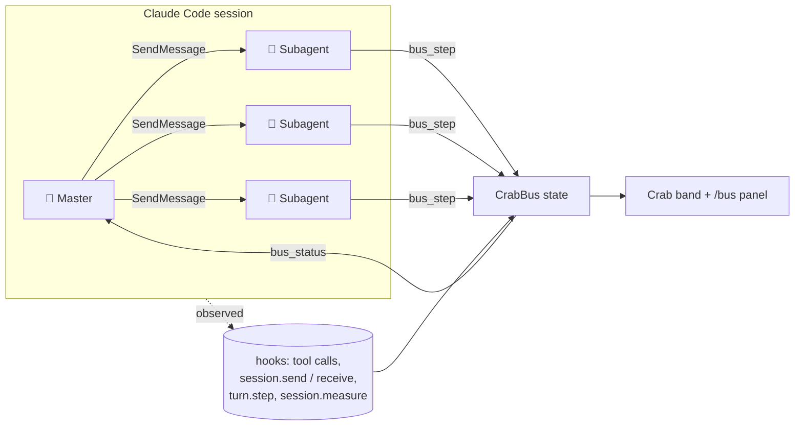

- **Star topology:** the master talks to its agents and the agents report back. CrabBus doesn't
  add a second mailbox or rewrite any message.
- **Cheap on context:** each spawned subagent gets one short paragraph (about 140 tokens) asking it
  to report with `bus_step`. The animation runs locally and costs **0 tokens per frame**.
- **Exact pixels:** sprites are hand-drawn at 18×14 and painted with half-block cells (`▀`, with
  the upper pixel as foreground and the lower one as background), so every pixel keeps its 24-bit
  color. Terminal frames are swapped as a single raster, without redrawing the UI tree. Desktop
  converts the same pixel canvas into SVG rectangles, displayed as static images at 4 CSS pixels
  per art pixel. Client requests frames at `fps` without rebuilding the panel; its text maintenance
  refreshes list age labels every five seconds and detail transcripts every second; the wardrobe
  redraws on state or control changes. `reduceMotion` uses still images on both surfaces.

## Configuration

Set these with `/config`, or in settings under `pluginConfigs.crabbus.options`:

| Option | Default | |
|---|---|---|
| `fps` | `6` | animation frames per second (1–10), on terminal and Desktop |
| `reduceMotion` | `false` | one still frame per state and one refresh a second on both surfaces |
| `openOnStart` | `true` | show the panel as soon as Claude Code starts |
| `band` | `auto` | above the prompt: `auto` (quiet summary while the panel is hidden; Desktop keeps the master visible with an empty crew) · `stage` (full animated stage on both surfaces) · `off` |

## Performance

25-second **terminal** sample with 3 subagents running, on macOS (Desktop has not been benchmarked):

| | CPU (avg) | RSS (avg) |
|---|---|---|
| without CrabBus | 12.2 % | 467 MB |
| with CrabBus, animated (6 fps) | 15.3 % | 517 MB |
| with CrabBus, `reduceMotion` | 11.4 % | 506 MB |

## Limits

- On terminals of about 18 rows or fewer, Claude Code leaves no room above the prompt, so no crabs
  are drawn. The tools still work.
- "Delivered" is observed. "Acknowledged" and "applied" are the agent's own word.
- Subagent cost is an estimate at first-party list prices. Bedrock/Vertex pricing, fast mode and
  long-context premiums are not modelled.
- A subagent receives a message between tool calls, so a long `sleep` delays delivery.
- `claude -p` runs need tool permissions for subagents.

The design decisions and the alternatives that were rejected are in [DECISIONS.md](DECISIONS.md).

## Development

```bash
npm run spec                                              # unit specs (node --test)
claude plugin test .                                      # plugin kit tests
node tools/preview.ts --design my-hat.json --out hat.png  # preview a costume before installing it
```

For Desktop changes, also run `plugin test .` with the Claude Code binary bundled with the
running app. It may be older than the shell's `claude`; see [rendering compatibility](docs/RENDERING.md#desktop-layout).

## Credits

The crab and the costume ideas come from **savvy-progress** in
[JohnnyVizz/claude-kit](https://github.com/JohnnyVizz/claude-kit) (MIT), which in turn credits
DockCrab / Clawdy. Every sprite was redrawn by hand for the terminal. See
[LICENSES/ATTRIBUTION.md](LICENSES/ATTRIBUTION.md).

## License

[MIT](LICENSE) © [joaquinsalinas06](https://github.com/joaquinsalinas06)

<div align="center"><br>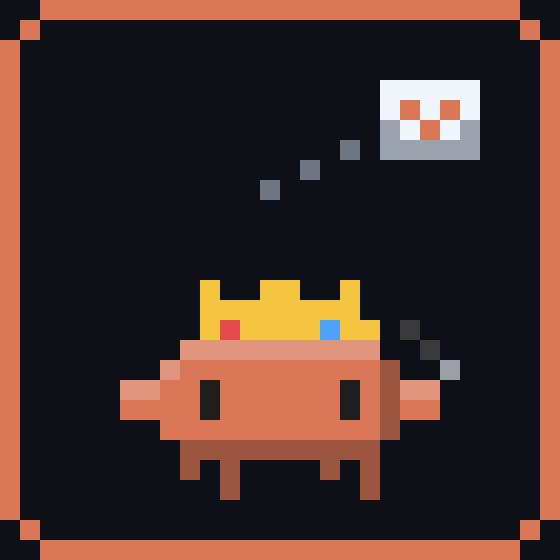</div>
