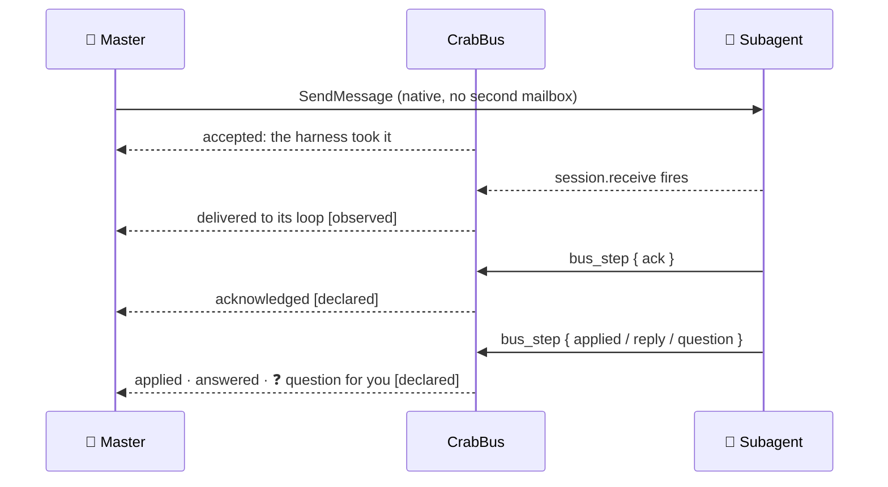
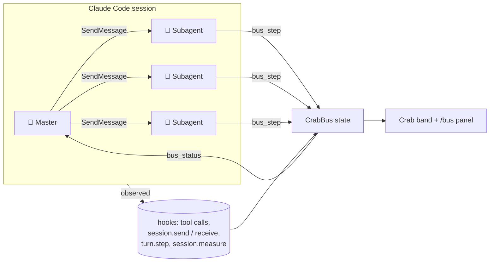

<div align="center">

<picture>
  <source media="(prefers-color-scheme: dark)" srcset="assets/wordmark-dark.png">
  <source media="(prefers-color-scheme: light)" srcset="assets/wordmark-light.png">
  
</picture>

### See what every Claude Code subagent is really doing, with pixel crabs.

[](LICENSE)
[](https://claude.com/claude-code)
[](tsconfig.json)
[](#requirements)
[](#how-it-works)

[Features](#features) · [Install](#install) · [Usage](#usage) · [Customize](#customize-your-crew-with-skills) · [How it works](#how-it-works) · [Configuration](#configuration)


</div>

---

**CrabBus** is a Claude Code mod for orchestrating ordinary subagents. The main agent (the
*master*) gets an accurate picture of what every subagent is doing, can message any of them and
track the message until it lands, and sees tokens and cost per agent. You see all of it live as a
crew of animated pixel crabs in your terminal.

<p align="center"></p>
<p align="center"><sub>A real recording: four Haiku subagents, tracked from launch to done (sped up 2×).</sub></p>

## Why

When a master launches five subagents in the background, it can't see what they are doing. It
waits, guesses, or sends the same instruction twice. Progress bars make it worse when "4 of 5
steps" is shown as "80 % done".

CrabBus keeps three kinds of information apart and never mixes them:

| Layer | Source | Example |
|---|---|---|
| **OBSERVED** | Claude Code's hooks: what actually happened | last tool and its argument, files edited, test commands and their result, tokens |
| **DECLARED** | The agent's own reports through `bus_step` | plan, stages done, current step, blockers, questions |
| **VERIFIED** | Declared stages that come with attached evidence | "stage 3: `npm test` → 42 passing" |

"4/5 stages declared done" is shown as exactly that, never as 80 % of the work.

## Features

### 🦀 A live crew above your prompt
One crab per running subagent, each in its own costume, acting out what it is **really** doing:
reading, writing, testing, thinking, blocked, error, done or asleep. The crowned master stands on
the right. Envelopes fly from the master to an agent and rest on its head until the agent
acknowledges them.

<p align="center"></p>

### ✉️ Two-way messaging you can trust
Messages travel both ways, and every hop is labeled with how CrabBus knows about it:



- **Master → agent:** the master uses Claude Code's own `SendMessage`. CrabBus watches it and does
  not change it.
- **Agent → master:** subagents report their plan, progress, blockers, **questions** and replies
  with `bus_step`. A question shows up as a ❓ on the crab and in `bus_status`.
- **You → agent:** open any agent in the `/bus` panel and type a message to it. It is tracked like
  the master's own messages.

### 💸 Tokens, cost and your plan's usage limits
- Each subagent's token usage (in, out, cache hits) and **context window in use**, read from every
  model request (`turn.step`).
- An estimated cost per agent at list prices, always shown with `≈` because no API reports a
  subagent's real cost.
- The **real session total** from Claude Code's own ledger (`session.measure`), with a sparkline.
  The master's share is the total minus the estimates.
- Your plan's **usage limits** always on screen: the current 5-hour window and the weekly one, as
  bars with the time left until each resets. No more typing `/usage` to check. They also show at the
  end of the line above the prompt (`5h 75% · week 54%`).

```
5h    ━━━━━━━━━━━━━━━━━━──────  75%  resets in 2h 41m
week  ━━━━━━━━━━━━━───────────  54%  resets in 4d 18h
```

### 📊 The `/bus` panel
<p align="center"></p>

- **METRICS:** declared stages as `done/total`, the master's context, tokens in/out, the real
  cost with a sparkline, and tools in flight.
- **The master's card** with its delegation tree.
- **SUBAGENTS** as cards (full crab, state chip, current tool, stages, context bar, tokens, cost)
  or as compact rows. Filter them by all, active, attention or done.
- **ACTIVITY:** a live feed of events.
- **Agent detail:** its transcript, read from the session (`all / tools / reasoning`), a field
  to message it, and DETAILS (cost breakdown, cache hits, context cells, timing, tool history,
  declared stages with evidence, messages).

<p align="center"></p>

| Key | Action |
|---|---|
| `1`–`9` or click | open an agent |
| `p` / `n` | previous / next agent |
| `b` | back to the list |
| `m` | cards ↔ rows |
| `f` | filter: all · active · attention · done |
| `t` | transcript tab: all · tools · reasoning |

### 🚦 Permission requests stay visible
When Claude Code asks *you* to approve a subagent's tool call, that crab turns **blocked** and
shows the command until you answer Claude Code's own dialog. The panel only displays the request.
A plugin can't answer or close that dialog, and CrabBus doesn't pretend it can.

## Customize your crew with skills

Ask for a costume in plain words and the bundled **`design` skill** draws it:

> *"Give the reviewer a capybara hat"* · *"a Christmas costume for everyone"* · *"make it jump when it runs `git commit`"*

<p align="center"></p>

Every crab above was made by asking the skill, and all of them ship in [`examples/`](examples):

| File | What it adds | Kind |
|---|---|---|
| [`capybara.crab.json`](examples/capybara.crab.json) | a plush capybara hood | costume |
| [`capybara-fisher.crab.json`](examples/capybara-fisher.crab.json) | a crochet capybara bucket hat | costume |
| [`french.crab.json`](examples/french.crab.json) | grey beret and curly mustache | costume |
| [`dino.crab.json`](examples/dino.crab.json) | hood, suit and tail | costume |
| [`christmas.crab.json`](examples/christmas.crab.json) | santa hat and scarf | costume |
| [`commit.crab.json`](examples/commit.crab.json) | confetti and a jump whenever an agent runs `git commit` | action |
| [`rules.json`](examples/rules.json) | who wears what: by agent description (`dino`, `fisher`…) and everyone in Christmas from Dec 1–31 | rules |

```bash
/costume import examples/dino.crab.json   # validated again on import
```

The skill handles more than costumes:

- **Actions:** a new animation tied to a tool call, such as `git commit` in the table above.
- **Rules:** who wears what, matched by agent type, name, description, model or date range.
- **Labels:** rename any state (`"thinking": "… pondering"`).

- Every costume, piece and action is **JSON data**, never code, kept in
  `~/.claude/crabbus/` (`/costume folder` prints the exact path).
- A **fit validator** draws each design in every action and frame, and rejects it if a piece
  floats, overflows the card, hides the eyes by accident or lacks contrast on dark or light
  terminals.
- Designs **reload live** within about 2 seconds, with no restart.
- **Share** them: `/costume export <id>` and `/costume import <file>`. `/costume list` shows what
  is installed.

Built-in crew: astronaut, detective, engineer, chef, pilot, pirate and propeller cap, plus the
crowned master. Costumes go to agents by role, and you can change who wears what.

## Requirements

| | |
|---|---|
| **Claude Code** | 2.1.296 or newer, in a terminal |
| **Terminal** | truecolor recommended. In 256-color terminals the crabs are approximated |
| **Size** | about 19 rows or more for the crab band; the panel adapts down to narrow widths |
| **OS** | tested on **macOS**. Linux should work (nothing is OS-specific). Windows is untested |
| **tmux** | ❌ not needed |
| **Node / npm** | ❌ not needed to use it, only to run the specs |

> Drawing happens only in the terminal. In Claude Desktop, the VS Code panel, `claude -p` and
> cloud sessions nothing is drawn, but `bus_status` and `bus_step` still work.

## Install

```bash
claude plugin marketplace add joaquinsalinas06/crabbus
claude plugin install crabbus@crabbus-local
```

Then run `/reload-plugins` in an open session. To try it for one session without installing:

```bash
git clone https://github.com/joaquinsalinas06/crabbus.git
claude --plugin-dir ./crabbus
```

## Usage

Ask the master as you normally would:

> *"How are the subagents doing? Tell the third one to switch to the v2 API."*

The master calls `bus_status`, which returns each agent's id and its three layers, and then calls
`SendMessage({ to: "<id>", ... })`.

> [!TIP]
> **Address agents by id.** Claude Code rejects `SendMessage` to a description such as `"backend"`
> unless the agent was spawned with a `name`.

| Tool | Who calls it | What it does |
|---|---|---|
| `mcp__crabbus__bus_status` | master | every agent's OBSERVED / DECLARED / VERIFIED state and message delivery (optional filter by id or name) |
| `mcp__crabbus__bus_step` | subagents | report plan, stages done, current step, evidence, blockers, questions, replies, ack / applied |

| Command | |
|---|---|
| `/bus` | open the panel |
| `/costume list · folder · reload · export · import · migrate` | manage crab designs |

## How it works



- **Star topology:** the master talks to its agents and the agents report back. CrabBus doesn't
  add a second mailbox or rewrite any message.
- **Cheap on context:** each spawned subagent gets one short paragraph (about 140 tokens) asking it
  to report with `bus_step`. The animation runs locally and costs **0 tokens per frame**.
- **Exact pixels:** sprites are hand-drawn at 18×14 and painted with half-block cells (`▀`, with
  the upper pixel as foreground and the lower one as background), so every pixel keeps its 24-bit
  color. Frames are swapped as a single raster, without redrawing the UI tree.

## Configuration

Set these with `/config`, or in settings under `pluginConfigs.crabbus.options`:

| Option | Default | |
|---|---|---|
| `fps` | `6` | animation frames per second (1–10) |
| `reduceMotion` | `false` | one still frame per state and one refresh a second |
| `openOnStart` | `true` | show the panel as soon as Claude Code starts |
| `band` | `auto` | above the prompt: `auto` (one quiet line while the panel is hidden) · `stage` (full animated stage) · `off` |

## Performance

25-second sample with 3 subagents running, on macOS:

| | CPU (avg) | RSS (avg) |
|---|---|---|
| without CrabBus | 12.2 % | 467 MB |
| with CrabBus, animated (6 fps) | 15.3 % | 517 MB |
| with CrabBus, `reduceMotion` | 11.4 % | 506 MB |

## Limits

- On terminals of about 18 rows or fewer, Claude Code leaves no room above the prompt, so no crabs
  are drawn. The tools still work.
- "Delivered" is observed. "Acknowledged" and "applied" are the agent's own word.
- Subagent cost is an estimate at first-party list prices. Bedrock/Vertex pricing, fast mode and
  long-context premiums are not modelled.
- A subagent receives a message between tool calls, so a long `sleep` delays delivery.
- `claude -p` runs need tool permissions for subagents.

The design decisions and the alternatives that were rejected are in [DECISIONS.md](DECISIONS.md).

## Development

```bash
npm run spec                                              # unit specs (node --test)
claude plugin test .                                      # plugin kit tests
node tools/preview.ts --design my-hat.json --out hat.png  # preview a costume before installing it
```

## Credits

The crab and the costume ideas come from **savvy-progress** in
[JohnnyVizz/claude-kit](https://github.com/JohnnyVizz/claude-kit) (MIT), which in turn credits
DockCrab / Clawdy. Every sprite was redrawn by hand for the terminal. See
[LICENSES/ATTRIBUTION.md](LICENSES/ATTRIBUTION.md).

## License

[MIT](LICENSE) © [joaquinsalinas06](https://github.com/joaquinsalinas06)

<div align="center"><br></div>
